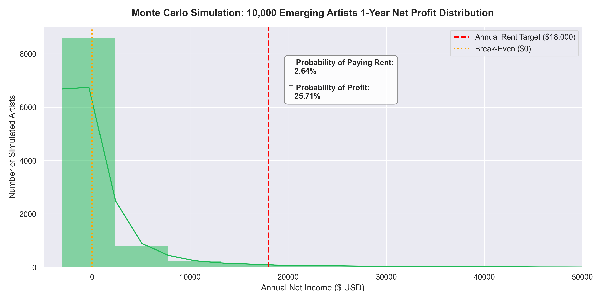

# 🎵 The Streaming Money Machine
🔗 **[Click Here to View Interactive Tableau Dashboard](https://prod-ch-a.online.tableau.com/#/site/mosestv2244-638548aa76/views/SpotifyTheStreamingMoneyMachine/Dashboard1)**
> **Can an Independent Artist Actually Pay Rent from Spotify?**

## 📌 Executive Summary
Every bedroom producer dreams of making a living on Spotify. But what do the unit economics actually look like? 

This end-to-end data project combines **114,000+ Spotify track records**, custom financial P&L modeling, and a **10,000-artist Monte Carlo simulation** to quantify streaming revenue, evaluate income inequality across artist tiers, and determine the true mathematical odds of paying basic rent from music streaming alone.

---

## 💡 Key Analytical Findings

### 1️⃣ SQL Wealth Inequality Analysis (114,000+ Tracks)
* **The Winner-Take-All Economy:** Superstar-tier artists average **$232,639** per track, while Unheard-tier artists average **$40 per track**.
* **Living Salary Target ($50,000/yr):**
  * Mid-tier artists need ~**11 active tracks** to earn a living wage.
  * Underground artists need ~**132 active tracks**.
  * Unheard artists would need to release **1,250 tracks**.

### 2️⃣ Excel Scenario Financial Model
* **Bedroom Producer (15K streams/mo):** Net Annual Loss of **-$508** (`NO ❌`). Requires **468,627 monthly streams** to break even and pay rent.
* **Rising Indie (150K streams/mo):** Net Annual Loss of **-$230** (`NO ❌`). Requires **596,814 monthly streams** to break even and pay rent.
* **Viral Breakthrough (2.5M streams/mo):** Net Annual Profit of **+$86,800** (`YES ✅`).

### 3️⃣ Python Monte Carlo Simulation (10,000 Simulated Careers)
* **Probability of Profit (> $0):** **25.71%**
* **Probability of Paying Rent (≥ $18,000/yr):** **2.64%**
* **Conclusion:** Only ~2.6% of emerging artists can rely on streaming as a primary income source without supplemental income streams (merch, touring, licensing).

---

## 🛠️ Tech Stack & Methodology
* **Database & Querying:** SQLite (DB Browser) — CTEs, NTILE Window Functions, Aggregations.
* **Financial Modeling:** Microsoft Excel — Dynamic P&L scenario engine, break-even stream formulas, conditional formatting logic.
* **Data Science & Simulation:** Python (`NumPy`, `Pandas`, `Matplotlib`, `Seaborn`) — Monte Carlo stochastic simulation over 12-month timelines.
* **Interactive Dashboard:** Tableau Public — *(Coming Next)*

---

## 📂 Repository Structure